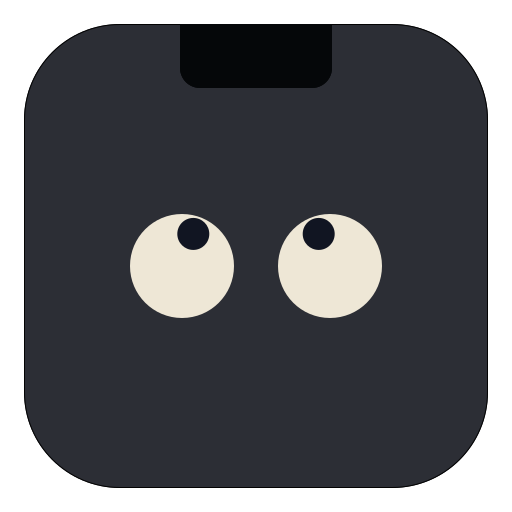
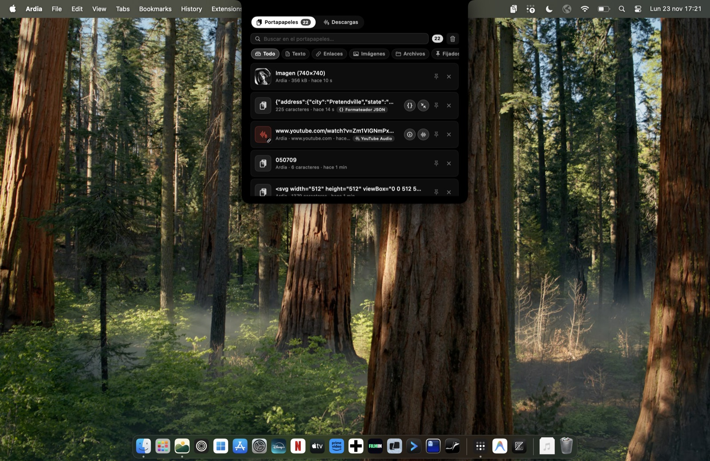
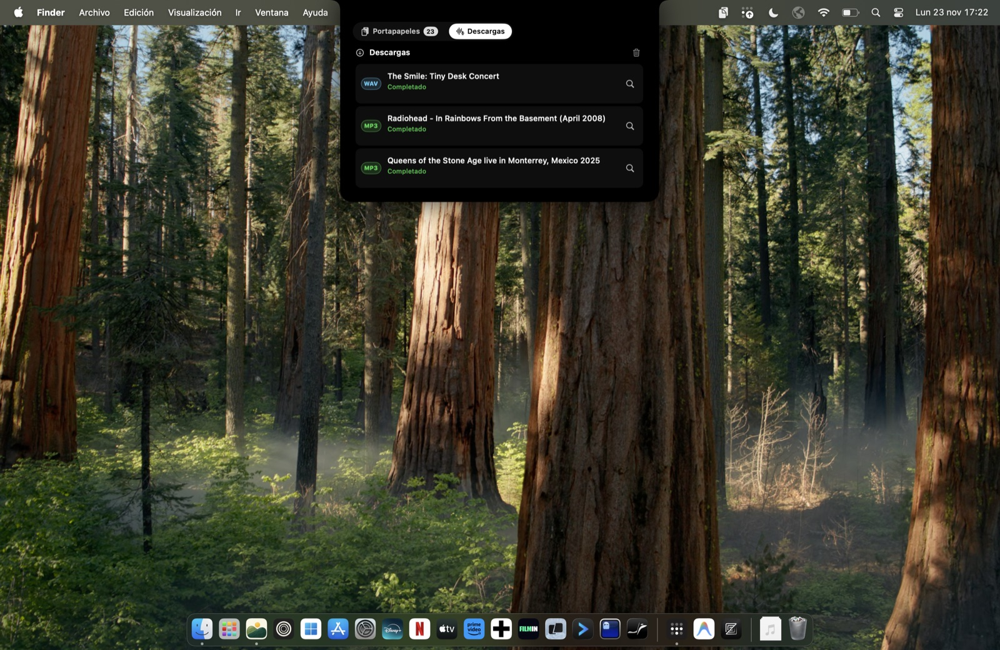

<p align="center">
  
</p>

<h1 align="center">Notchtambule</h1>

<p align="center">
  <strong>El notch de tu Mac, convertido en un centro de portapapeles y acciones rápidas.</strong>
</p>

<p align="center">
  <a href="https://github.com/theroich/notchtambule/releases/latest"><strong>⬇️ Descargar la última versión</strong></a>
  ·
  <a href="doc/README.md">Documentación técnica</a>
</p>

---

## Qué es Notchtambule

**Notchtambule** es una aplicación nativa de macOS que vive en la barra de menús y utiliza el notch de la cámara —o la parte superior de la pantalla en Macs sin notch— como interfaz para consultar y reutilizar todo lo que copias.

Cada vez que copias un texto, un enlace, una imagen o un archivo, Notchtambule lo guarda en un historial local con búsqueda, filtros, fijados y pegado directo. Además, analiza el contenido y ofrece **acciones contextuales**: descargar el audio de un vídeo de YouTube, limpiar los parámetros de seguimiento de una URL, formatear un JSON o convertir un color a otro formato.

Todo ocurre en tu Mac: sin cuentas, sin nube y sin telemetría. El historial y las preferencias se guardan en local. La única excepción es el módulo **YouTube Audio**, que consulta la URL del vídeo en el endpoint público oEmbed de YouTube para obtener título, canal y miniatura.

<p align="center">
  
  <br>
  <em>Historial del portapapeles en el notch: búsqueda, filtros, aplicaciones de origen y acciones de los módulos.</em>
</p>

## Funcionalidades

### Portapapeles

- **Historial universal** de texto, enlaces, imágenes y archivos.
- **Búsqueda instantánea** y filtros por tipo: todo, texto, enlaces, imágenes, archivos y elementos fijados.
- **Deduplicación** de copias repetidas mediante hash SHA-256.
- **Elementos fijados** que nunca se eliminan automáticamente.
- **Límite configurable** de 10 a 500 elementos.
- **Persistencia local** opcional entre reinicios.
- **Aplicación de origen** y marca temporal en cada elemento.
- **Clic para pegar** en la aplicación que tenía el foco, o `⌥ + clic` para solo copiar.
- **Privacidad por defecto**: ignora contenido marcado como confidencial o transitorio por gestores de contraseñas y otras apps.

### Notch

- Se abre al **acercar el cursor** al notch.
- Pestañas dinámicas para el **Portapapeles** y los paneles de actividad de los módulos.
- Contadores en tiempo real de elementos y tareas activas.
- Se adapta a Macs con y sin notch y a configuraciones con varias pantallas.
- Los avisos contextuales se cierran solos y se pausan mientras el cursor permanece encima.

### Módulos integrados

| Módulo | Qué hace |
|---|---|
| **YouTube Audio** | Detecta enlaces de YouTube y descarga el audio en **MP3** o **WAV** con `yt-dlp` y `ffmpeg`. Muestra título, canal y miniatura, gestiona una cola de descargas y reintenta automáticamente los errores 403. |
| **Limpiador de URLs** | Elimina parámetros de seguimiento (`utm_*`, `fbclid`, `gclid`, `igshid`, `si`, etc.) conservando el resto de la URL. |
| **Formateador JSON** | Formatea (`Prettify`) o compacta (`Minify`) documentos JSON válidos. |
| **Conversor de color** | Convierte colores `#RGB`, `#RRGGBB`, `#RRGGBBAA` y `rgb(r, g, b)` a HEX, RGB o `Color` de SwiftUI. |
| **Developer Toolkit** | Decodifica JWT (header y payload sin verificar firma), texto Base64 / Base64URL y URLs o textos con percent-encoding (`%XX`). |

> **Nota sobre Developer Toolkit:** Todo el análisis se ejecuta en local. La decodificación de JWT es solo estructural (no verifica firmas criptográficas ni sustituye a una librería de validación); Base64 admite alfabeto estándar (`+`, `/`) y Base64URL (`-`, `_`) con padding opcional; y la decodificación de URL aplica percent-encoding estándar sin convertir `+` en espacio.

<p align="center">
  
  <br>
  <em>Cola de descargas de YouTube Audio, con formato, estado y acceso al archivo final.</em>
</p>

### Más

- **Menú de barra** con los elementos recientes y accesos a las acciones principales.
- **Ajustes modulares** (`⌘,`) para activar o desactivar cada módulo, elegir su modo de disparo y configurar sus preferencias.
- **Español e inglés**, con selector de idioma.
- **Arquitectura de módulos** pensada para añadir nuevas funcionalidades sin tocar el núcleo.
- **Swift 6**, SwiftUI y AppKit, con comprobación estricta de concurrencia.

## Instalación

### Descargar una versión publicada

1. Abre **[la última release](https://github.com/theroich/notchtambule/releases/latest)**.
2. Descarga el `.dmg` (o el `.zip`) y arrastra **Notchtambule.app** a `/Applications`.
3. Abre la app. Como las builds están firmadas en modo ad-hoc y no están notarizadas, macOS puede bloquearla la primera vez:
   - Haz **clic derecho → Abrir**, o
   - elimina la cuarentena desde Terminal:

   ```bash
   xattr -dr com.apple.quarantine "/Applications/Notchtambule.app"
   ```

4. Si quieres usar el módulo **YouTube Audio**, instala sus dependencias:

   ```bash
   brew install yt-dlp ffmpeg
   ```

5. Para el **pegado automático al hacer clic**, concede el permiso de **Accesibilidad** cuando la app lo solicite o desde **Ajustes del Sistema → Privacidad y seguridad → Accesibilidad**.

> Las releases incluyen el `.dmg`, el `.zip` y un archivo `SHA256SUMS.txt` para verificar las descargas.

### Requisitos

| Componente | Versión / notas |
|---|---|
| macOS | 14 Sonoma o superior |
| `yt-dlp` + `ffmpeg` | Opcionales. Solo necesarios para el módulo YouTube Audio. |
| Accesibilidad | Opcional. Necesaria para pegar automáticamente con `⌘V`. |

## Uso rápido

1. **Copia algo** con `⌘C` en cualquier aplicación.
2. **Pulsa `⌃⌘V`** (`Control + Command + V`) desde cualquier app —o **acerca el cursor al notch**— para abrir el panel del portapapeles.
3. **Navega con `↑` / `↓`** y pulsa **`Enter`** (o **haz clic en un elemento**) para pegarlo en la app que tenías activa; mantén `⌥` (`⌥ + Enter` o `⌥ + clic`) para copiarlo sin pegar, o pulsa **`Esc`** para cerrar sin pegar.
4. Usa los **botones de acción** de cada fila para ejecutar las acciones del módulo que reconoce ese contenido.
5. Abre **Ajustes** con `⌘,` para cambiar el límite del historial, la privacidad, el idioma, el modo de disparo de cada módulo y la carpeta de descargas.

También puedes abrir el panel desde el **icono de la barra de menús** si el hover no está disponible. (El atajo global `⌃⌘V` es fijo por ahora; su personalización queda fuera de esta versión.)

## Construir desde el código

Requisitos: **Xcode 16 o superior** (no basta con Command Line Tools, porque DynamicNotchKit usa el macro `@Entry` de SwiftUI) y Swift 6.

```bash
git clone https://github.com/theroich/notchtambule.git
cd notchtambule

./Scripts/build-app.sh
open build/Notchtambule.app
```

Para ejecutar los tests:

```bash
swift test
```

El flujo completo de desarrollo, la estructura del proyecto, la arquitectura y la guía para crear nuevos módulos están en [`doc/`](doc/README.md).

## Releases

Las versiones se publican como tags `vX.Y.Z` desde GitHub Actions, con artefactos `.dmg`, `.zip` y checksums:

- **[Última release](https://github.com/theroich/notchtambule/releases/latest)**
- **[Todas las releases](https://github.com/theroich/notchtambule/releases)**

El proceso de publicación y versionado está documentado en [`doc/desarrollo.md`](doc/desarrollo.md#versionado-y-releases).

## Documentación técnica

| Documento | Contenido |
|---|---|
| [`doc/README.md`](doc/README.md) | Índice y punto de entrada |
| [`doc/estructura.md`](doc/estructura.md) | Estructura de carpetas y responsabilidades |
| [`doc/arquitectura.md`](doc/arquitectura.md) | Flujos, estado, servicios y decisiones de diseño |
| [`doc/como-crear-extensiones.md`](doc/como-crear-extensiones.md) | Guía paso a paso para crear módulos nuevos |
| [`doc/api-plugins.md`](doc/api-plugins.md) | Referencia del protocolo y de los modelos |
| [`doc/desarrollo.md`](doc/desarrollo.md) | Build, tests, localización y releases |
